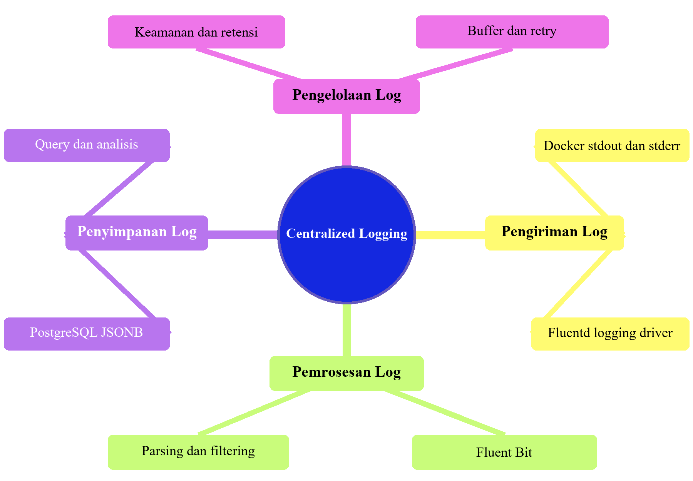

# LAPORAN PRAKTIKUM
## TUGAS BAB 6: CENTRALIZED LOGGING DENGAN FLUENT BIT DAN POSTGRESQL

Dosen Pengampu: Ferry Astika Saputra, S.T., M.Sc.  
Disusun Oleh:  
Adam Rasyid Nurmuhammad  
3126640025  
D4-IT-B  


**PROGRAM STUDI SARJANA TERAPAN**  
**JURUSAN TEKNIK INFORMATIKA**  
**DEPARTEMEN TEKNIK INFORMATIKA DAN KOMPUTER**  
**POLITEKNIK ELEKTRONIKA NEGERI SURABAYA**  
**2026**  

## DAFTAR ISI
- BAB I PENDAHULUAN
- BAB II LANDASAN TEORI
- BAB III PENGERJAAN PRAKTIKUM
- BAB IV EVALUASI DAN LATIHAN

# BAB I PENDAHULUAN

## 1.1 Latar Belakang

Pada praktikum Bab 6 ini, dibangun arsitektur Centralized Logging dengan mengintegrasikan tiga pilar utama:

1. Docker Fluentd Logging Driver: Mengalirkan stream dari kontainer aplikasi secara otomatis ke collector pada port TCP 24224 menggunakan mode non-blocking asinkron (fluentd-async: "true"), memastikan ketiadaan backpressure langsung pada performa aplikasi.
2. Fluent Bit (v4.2.8): Berfungsi sebagai log collector, router,
3. PostgreSQL 16 (Alpine): Bertindak sebagai repositori penyimpanan log (storage backend). Melalui dukungan tipe data semiterstruktur JSONB dan pengindeksan terbalik (Generalized Inverted Index / GIN), PostgreSQL memungkinkan mahasiswa mempelajari konsep pemodelan data log, eksekusi kueri agregasi, analisis performa pengindeksan, serta implementasi siklus hidup retensi data secara terkontrol.
# BAB II LANDASAN TEORI

## 2.1 Peta Konsep: Centralized Logging dan Penyimpanan Log



Dalam arsitektur Centralized Logging terdapat empat bagian utama:

- Pengiriman log: Aplikasi dalam kontainer menulis log ke stdout dan stderr, lalu Fluentd logging driver Docker meneruskannya ke Fluent Bit.
- Pemrosesan log: Fluent Bit menerima log, melakukan parsing agar isinya terstruktur, dan menerapkan filtering sebelum mengirimkannya ke penyimpanan.
- Penyimpanan log: PostgreSQL menyimpan log dalam format JSONB sehingga isinya dapat dicari melalui query dan dianalisis.
- Pengelolaan log: Buffer dan retry membantu menangani gangguan pengiriman, sedangkan keamanan dan retensi mengatur perlindungan serta lama penyimpanan log.
Jadi, alur utamanya adalah pengiriman → pemrosesan → penyimpanan, dengan pengelolaan log mendukung seluruh alur tersebut.

# BAB III PENGERJAAN PRAKTIKUM

Struktur direktori kerja yang akan dibentuk pada praktikum ini:

```text
bab-6/
├── .env.example
├── .env
├── .gitignore
├── compose.yaml
├── fluent-bit/
│   └── fluent-bit.conf
├── init/
│   └── 01-init-logging.sh
├── queries/
│   └── analysis.sql
└── scripts/
    ├── generate-logs.sh
    └── test-buffering.sh
```

## 3.1 Persiapan Direktori Kerja Bab 6


*Gambar 3.1: Pembuatan Struktur Direktori Proyek Bab 6 pada WSL 2*

## 3.2 Pembuatan Template Variabel Lingkungan (.env.example)

Untuk memisahkan konfigurasi sensitif dari berkas deklarasi layanan compose.yaml, disusun berkas template .env.example. Berkas ini memuat parameter konfigurasi sintetis untuk akun basis data PostgreSQL dan kredensial ingest Fluent Bit.


*Gambar 3.2: Penulisan Variabel Lingkungan Template pada .env.example*

## 3.3 Aktivasi Konfigurasi Lokal (.env) dan Pengamanan Hak Akses

Setelah berkas template siap, dilakukan penggandaan menjadi berkas aktif .env. Mengikuti prinsip Least Privilege, hak akses berkas dikunci secara ketat ke mode 600 (read-write hanya untuk pemilik akun lokal) agar pengguna lain di sistem operasi tidak dapat membaca kredensial tersebut.

Perintah yang dieksekusi:

```text
cp .env.example .env
chmod 600 .env
```


*Gambar 3.3: Penggandaan Berkas .env dan Pengetatan Izin Hak Akses (chmod 600)*

## 3.4 Konfigurasi Proteksi Repositori Melalui Berkas .gitignore

Untuk mencegah kebocoran kredensial ke repositori publik Git, dibuat berkas .gitignore. Berkas ini mengecualikan berkas .env, berkas log berakhiran .log, dan direktori laporan dari pelacakan version control.

Isi berkas .gitignore:

```text
.env
*.log
reports/
```


*Gambar 3.4: Definisi Pengecualian Berkas Rahasia pada .gitignore*

## 3.5 Orkestrasi Multi-Container Stack pada Berkas compose.yaml

Layanan di write dalam berkas orkestrasi compose.yaml. Berkas ini mendefinisikan lima layanan kontainer:

1. postgres-db: Menggunakan citra postgres:16-alpine, mengaktifkan volume persisten pg-data, mengaitkan direktori inisialisasi ./init secara read-only (:ro), serta menyertakan pemeriksaan kesehatan (healthcheck) berbasis pg_isready.
2. fluent-bit: Menggunakan citra resmi fluent/fluent-bit:4.2.8, mempublikasikan port forwarder 24224 dan port monitoring 2020 ke host (127.0.0.1), menerapkan opsi keamanan no-new-privileges:true, serta bergantung pada status sehat PostgreSQL (condition: service_healthy).
3. generator-auth: Kontainer Alpine yang membangkitkan 20 baris log INFO login sintetis berformat JSON ke stdout.
4. generator-api: Kontainer Alpine yang membangkitkan 20 baris log WARN metrik latensi ke stdout.
5. generator-worker: Kontainer Alpine yang membangkitkan 20 baris log ERROR percobaan ulang (retry attempt) ke stdout.
Ketiga generator dikonfigurasi dengan opsi driver Docker fluentd:

```text
logging:
  driver: fluentd
  options:
    fluentd-address: "127.0.0.1:24224"
    fluentd-async: "true"
    tag: "docker.{{.Name}}"
```


*Gambar 3.5: Deklarasi Layanan Multi-Container pada compose.yaml*

Opsi fluentd-async: "true" menjamin Docker engine menangani kegagalan kolektor secara asinkron tanpa memblokir siklus eksekusi utama kontainer penghasil log.

## 3.6 Inisialisasi Skema Database, Role, dan View pada init/01-init-logging.sh

Berkas skrip init/01-init-logging.sh dieksekusi secara otomatis saat kontainer PostgreSQL pertama kali diinisialisasi. Skrip ini bertugas:

- Membuat role khusus ingest fluentbit_user dengan kata sandi terenkripsi.
- Membuat skema terisolasi logs.
- Membuat tabel logs.fluentbit dengan kolom tag (TEXT), time (TIMESTAMP WITHOUT TIME ZONE), dan data (JSONB).
- Membangun indeks temporal B-tree idx_fluentbit_time dan indeks tag idx_fluentbit_tag.
- Membangun indeks terbalik GIN idx_fluentbit_data_gin pada kolom data untuk percepatan evaluasi kueri semiterstruktur.
- Membuat objek View logs.recent_logs untuk menyederhanakan inspeksi log operasional.
- Mengatur search_path role fluentbit_user ke logs, public serta memberikan hak akses USAGE, CREATE, SELECT, dan INSERT secara terukur.


*Gambar 3.6: Skrip Inisialisasi Skema Basis Data, Indeks GIN, dan Role pada PostgreSQL*

## 3.7 Konfigurasi Pipeline Ingest, Buffer, dan Egress pada fluent-bit/fluent-bit.conf

Konfigurasi inti Fluent Bit ditulis pada berkas fluent-bit/fluent-bit.conf. Konfigurasi ini mengatur:


- Bagian `[SERVICE]`: Menetapkan interval flush 1 detik, tingkat log info, direktori penyimpanan disk buffer /var/log/flb-storage dengan verifikasi checksum aktif (storage.checksum on), batas memori backlog 10MB, serta mengaktifkan server HTTP monitoring pada port 2020.
- Bagian `[INPUT]`: Menerima protokol Forward pada port 24224 dengan tipe buffer filesystem (storage.type filesystem) dan batas memori 10MB.
- Bagian `[OUTPUT]` pgsql: Mengalirkan rekaman data ke layanan postgres-db port 5432 ke tabel fluentbit dengan batasan kuota disk buffer 256MB (storage.total_limit_size 256M).
- Bagian `[OUTPUT]` stdout: Mencetak rekaman ke konsol lokal berformat json_lines untuk kebutuhan inspeksi visual pengujian.
*Gambar 3.7: Definisi Pipeline Input Forward, Storage Buffer, Output pgsql, dan Stdout*

## 3.8 Skrip Kueri SQL untuk Analisis dan Observabilitas pada queries/analysis.sql

Untuk mempermudah verifikasi dan analisis agregasi data log yang tersimpan di PostgreSQL, disusun berkas kueri SQL queries/analysis.sql. Berkas ini memuat kueri penghitungan total event dan rentang waktu, agregasi distribusi event per tag Docker, ekstraksi metadata terstruktur dari objek JSONB, penyaringan log berdasarkan keparahan (severity ERROR), serta agregasi laju ingest log per menit (minute bucket).


*Gambar 3.8: Penyusunan Kueri SQL Agregasi, Ekstraksi JSONB, dan Ringkasan Laju Ingest*

## 3.9 Skrip Otomasi Pembangkitan Log pada scripts/generate-logs.sh

Skrip scripts/generate-logs.sh berfungsi mengotomatisasi siklus pembangkitan log. Skrip ini memastikan basis data dan kolektor Fluent Bit telah berjalan sehat melalui pemeriksaan endpoint /api/v1/health, kemudian menjalankan ulang ketiga generator (generator-auth, generator-api, generator-worker) menggunakan flag --force-recreate.


*Gambar 3.9: Skrip Otomasi Validasi Kesiapan Kolektor dan Eksekusi Ulang Generator*

## 3.10 Skrip Pengujian Ketahanan Buffer Filesystem pada scripts/test-buffering.sh

Skrip scripts/test-buffering.sh dirancang untuk menguji ketahanan (resilience) dan pembuktian semantik at-least-once delivery Fluent Bit saat PostgreSQL mengalami pemadaman (downtime). Alur pengujian meliputi:

1. Menghitung jumlah awal baris log pada tabel logs.fluentbit.
2. Menghentikan sementara kontainer postgres-db (docker compose stop postgres-db).
3. Memicu eksekusi generator log selama 25 detik saat basis data mati.
4. Menghidupkan kembali postgres-db dan menunggu statusnya kembali sehat.
5. Memverifikasi bahwa jumlah rekaman pada basis data bertambah setelah pemulihan, membuktikan bahwa Fluent Bit berhasil menampung event di buffer disk dan mengirimkannya kembali (flush) begitu basis data aktif.


*Gambar 3.10: Skrip Otomasi Pengujian Failover, Buffering Disk, dan Verifikasi Pemulihan*

## 3.11 Pemberian Hak Akses Eksekusi dan Validasi Statis Berkas Shell/Compose

Sebelum menjalankan stack, seluruh skrip shell diberi izin eksekusi (chmod +x). Selanjutnya, dilakukan analisis statis menggunakan flag bash -n untuk memastikan tidak ada kesalahan sintaks bash, serta docker compose config --quiet untuk memvalidasi skema YAML dan substitusi variabel lingkungan.


*Gambar 3.11: Eksekusi chmod +x, Validasi Sintaks bash -n, dan Uji Validitas compose.yaml*

Hasil eksekusi tidak menampilkan pesan kesalahan (exit code 0), menandakan seluruh berkas konfigurasi valid.

## 3.12 Validasi Konfigurasi Fluent Bit tanpa Menjalankan Seluruh Stack

Untuk memastikan konfigurasi fluent-bit.conf bebas dari parameter usang (deprecated atau unknown properties) sebelum layanan dijalankan secara penuh, dilakukan pengujian dry-run menggunakan perintah kontainer independen:

```text
docker compose run --rm --no-deps fluent-bit   --dry-run   --config=/fluent-bit/etc/fluent-bit.conf
```


*Gambar 3.12: Validasi Konfigurasi Fluent Bit 4.2.8 Menunjukkan Sintaks Konfigurasi Valid*

Output log mengonfirmasi bahwa konfigurasi Fluent Bit dinyatakan valid dan siap dioperasikan.

## 3.13 Eksekusi Pipeline Logging dan Pembangkitan Event Telemetri

Eksekusi pipeline diawali dengan menjalankan skrip generate-logs.sh. Skrip memulai kontainer postgres-db dan fluent-bit, memverifikasi kesiapan endpoint HTTP, lalu menjalankan ketiga generator log.


*Gambar 3.13: Eksekusi Skrip Pembangkitan Log dan Verifikasi Status Layanan pada Docker Compose*

Setelah 25 detik, ketiga generator menunjukkan status Exited (0), yang merupakan kondisi normal karena proses pembangkitan 20 event telah selesai. Layanan postgres-db berstatus Up (healthy) dan fluent-bit berstatus Up.

## 3.14 Pemeriksaan Endpoint Observabilitas dan Metrik Internal Fluent Bit

Fluent Bit mengekspos endpoint pemantauan internal pada port 2020. Diperiksa status kesehatan dan metrik operasional menggunakan curl:

```text
curl -fsS http://127.0.0.1:2020/api/v1/health
curl -fsS http://127.0.0.1:2020/api/v1/metrics
```


*Gambar 3.14: Respons Status Sehat HTTP 200 dan Data Metrik Internal Ingest/Egress Fluent Bit*

Respons endpoint /api/v1/health mengembalikan status {"status":"ok"}. Endpoint /api/v1/metrics menampilkan metrik internal rinci yang membuktikan aliran data pada input forward.0 telah diteruskan secara presisi ke output pgsql.0.

## 3.15 Verifikasi Ingest Record Telemetri pada PostgreSQL Menggunakan Script Analisis

Kueri analitis dieksekusi langsung ke dalam basis data PostgreSQL menggunakan psql untuk membuktikan bahwa seluruh rekaman log berhasil disimpan.


*Gambar 3.15: Eksekusi File queries/analysis.sql Menampilkan Ringkasan dan Ekstraksi Metadata*

## 3.16 Validasi Evidence Agregasi Tag Docker dan Tampilan Ringkasan Log

Pemeriksaan lanjutan terhadap isi view logs.recent_logs membuktikan bahwa data log tersimpan rapi dengan metadata kontainer, stempel waktu, dan isi log yang terstruktur.

Perintah yang dieksekusi:

```text
docker compose exec -T postgres-db   psql   --username "$POSTGRES_USER"   --dbname "$POSTGRES_DB"   --command 'TABLE logs.recent_logs;'
```


*Gambar 3.16: Distribusi 20 Record per Generator dan Ekstraksi View logs.recent_logs*

Output terminal menunjukkan distribusi presisi: masing-masing tag docker.bab-6-generator-auth-1, docker.bab-6-generator-api-1, dan docker.bab-6-generator-worker-1 mencatatkan tepat 20 event (total 60 event), membuktikan ketiadaan data yang hilang pada kondisi normal.

## 3.17 Pengujian Ketahanan Buffering saat Layanan Database Dihentikan

Gunakan skrip test-buffering.sh. Layanan basis data dihentikan paksa saat generator menjalankan event, lalu dihidupkan kembali untuk membuktikan kemampuan pemulihan otomatis.


*Gambar 3.17: Eksekusi test-buffering.sh Membuktikan Penambahan Record setelah PostgreSQL Pulih*

Hasil pengujian menampilkan pesan sukses [PASS] Jumlah sesudah pemulihan: 120 dengan kenaikan tepat 60 record baru yang berhasil di-flush setelah PostgreSQL kembali beroperasi normal.

## 3.18 Verifikasi Retry Backoff Fluent Bit dan Kondisi Buffer Volume flb-storage

Untuk menganalisis perilaku Fluent Bit saat basis data down, diperiksa log kontainer Fluent Bit dan daftar volume Docker:

```text
docker compose logs --tail 200 fluent-bit
docker compose volume ls
```


*Gambar 3.18: Jejak Log Retry Exponential Backoff pada Fluent Bit dan Eksistensi Volume flb-storage*

Log Fluent Bit menampilkan peringatan [warn] [engine] failed to flush chunk ... retrying in X seconds. Hal ini membuktikan algoritma retry backoff bekerja menahan chunk di dalam volume persisten flb-storage hingga koneksi basis data pulih.

## 3.19 Verifikasi Tipe Data Kolom data sebagai jsonb pada PostgreSQL

Untuk memastikan skema data sesuai rancangan, dilakukan verifikasi tipe data kolom data pada tabel logs.fluentbit menggunakan fungsi bawaan pg_typeof():


*Gambar 3.19: Verifikasi Fungsi pg_typeof() Membuktikan Seluruh Record Bertipe Data jsonb*

Hasil kueri mengonfirmasi 100% record tersimpan dalam tipe data jsonb

## 3.20 Matriks Hasil Pengujian PASS/FAIL Berdasarkan Evidence Praktikum

Berdasarkan seluruh tahapan pengujian yang telah dilaksanakan, disusun matriks evaluasi pengujian PASS/FAIL pada Gambar 3.20 untuk memvalidasi keberhasilan setiap kriteria fungsionalitas dan keamanan.


*Gambar 3.20: Matriks Hasil Evaluasi Skenario Pengujian Berdasarkan Evidence Eksperimental*

Seluruh 7 skenario pengujian utama (validasi Compose, kesehatan backend, kesehatan kolektor, verifikasi skema, kelengkapan ingest, keandalan buffer failover, dan isolasi jaringan) memperoleh hasil PASS, membuktikan keandalan menyeluruh arsitektur logging yang dibangun.

# BAB IV EVALUASI DAN LATIHAN

## 4.1 Evaluasi dan Latihan Mandiri

1. Apa risiko kehilangan log ketika Fluent Bit tidak tersedia?
- Log dibuang diam-diam (silent drop): Jika menggunakan mode asinkron, memori penampungan sementara Docker akan penuh, sehingga log baru otomatis terbuang.
- Aplikasi macet: Jika menggunakan mode sinkron, proses pengiriman log yang gagal membuat aplikasi ikut tertahan (blocking) hingga bisa menyebabkan aplikasi berhenti merespons.
- Log yang tersimpan di dalam memori sementara akan langsung lenyap jika komputer atau layanan Docker di-restart saat Fluent Bit mati.
2. Mengapa structured logging lebih mudah dianalisis dibanding plain text logging?
Structured logging lebih mudah dianalisis karena menggunakan format standar berbasis pasangan key-value (seperti JSON) yang memungkinkan mesin untuk langsung memfilter, mencari, dan mengindeks data tanpa perlu proses parsing teks manual yang rumit..

3. Kapan PostgreSQL tidak lagi cocok sebagai log storage utama?
PostgreSQL tidak lagi cocok dijadikan penyimpanan log utama ketika volume data log menjadi sangat besar dan tinggi, sehingga menyebabkan penurunan performa serta pembengkakan biaya infrastruktur.

4. Apa perbedaan log untuk observability dan log untuk forensik?
Log untuk observability berfokus pada pemantauan kesehatan dan kinerja sistem secara real-time, sedangkan log untuk forensik berfokus pada investigasi mendalam untuk melacak akar masalah atau pelanggaran keamanan setelah suatu insiden terjadi.

5. Buat query SQL untuk menampilkan jumlah log per menit dalam 10 menit terakhir
Kueri SQL di bawah ini memanfaatkan fungsi temporal date_trunc() untuk mengelompokkan rekaman log ke dalam keranjang per menit (minute bucket) dengan filter rentang waktu dinamis 10 menit terakhir menggunakan indeks idx_fluentbit_time:

```sql
SELECT
    date_trunc('minute', time) AS minute_bucket,
    count(*) AS total_logs
FROM logs.fluentbit
WHERE time >= CURRENT_TIMESTAMP - INTERVAL '10 minutes'
GROUP BY minute_bucket
ORDER BY minute_bucket DESC;
```

Penjelasan:

- date_trunc('minute', time) membulatkan stempel waktu presisi tinggi ke menit terdekat, menyederhanakan agregasi berbasis interval waktu.
- Klausa WHERE time >= CURRENT_TIMESTAMP - INTERVAL '10 minutes' memanfaatkan indeks B-tree idx_fluentbit_time untuk melakukan pemindaian rentang indeks (Index Range Scan), menghindari pemindaian sekuensial seluruh tabel.
## 4.2 Analisis Wajib

- Masalah yang Muncul dan Cara Mendiagnosisnya
- Selama praktikum Bab 6 tidak ada kendala yang menghambat proses. Pipeline berjalan sesuai rancangan sejak konfigurasi awal, sehingga tidak ada perbaikan darurat yang perlu dilakukan.
- Jelaskan risiko keamanan atau operasional yang relevan pada bab ini.
Risiko nya Adalah

- Jika Fluent Bit atau PostgreSQL tidak tersedia, log dapat tertunda atau hilang ketika buffer penuh, disk gagal, atau proses berhenti paksa.
- Backpressure juga dapat memenuhi penyimpanan, sedangkan mekanisme retry berpotensi menghasilkan log duplikat.
- Dari sisi keamanan, log yang mencatat kata sandi, token, atau data pribadi dapat membocorkan informasi sensitif jika tidak disaring.
- Endpoint pemantauan Fluent Bit dan akses PostgreSQL perlu dibatasi agar tidak terbuka bagi pihak yang tidak berwenang.
- Kebijakan retensi yang tidak tepat juga berisiko menambah biaya dan paparan data, atau justru menghapus bukti yang diperlukan untuk investigasi.
- Rekomendasi Perbaikan untuk Production-like Environment
Simpan kredensial di pengelola secret dan batasi hak akses akun PostgreSQL sesuai tugasnya.

Batasi akses jaringan ke PostgreSQL dan endpoint pemantauan Fluent Bit, serta jangan membuka keduanya ke jaringan publik tanpa pengamanan yang sesuai

Terapkan penyaringan data sensitif sebelum log disimpan agar kata sandi, token, dan data pribadi tidak masuk ke repositori log.

Tetapkan kapasitas buffer, batas retry, pemantauan log yang gagal dikirim, serta uji pemulihan ketika PostgreSQL tidak tersedia.

Atur retensi, pengarsipan, dan pencadangan berdasarkan kebutuhan audit serta volume log yang diperkirakan.

## 4.3 Penggunaan AI dalam Pembelajaran

Dalam proses pembelajaran dan pengembangan proyek ini, Artificial Intelligence dimanfaatkan secara optimal sebagai pendukung untuk menguraikan, menerjemahkan, dan menjelaskan perintah kode dari praktikum ini, sekaligus membantu merancang dan menghasilkan visualisasi peta konsep yang sistematis.
